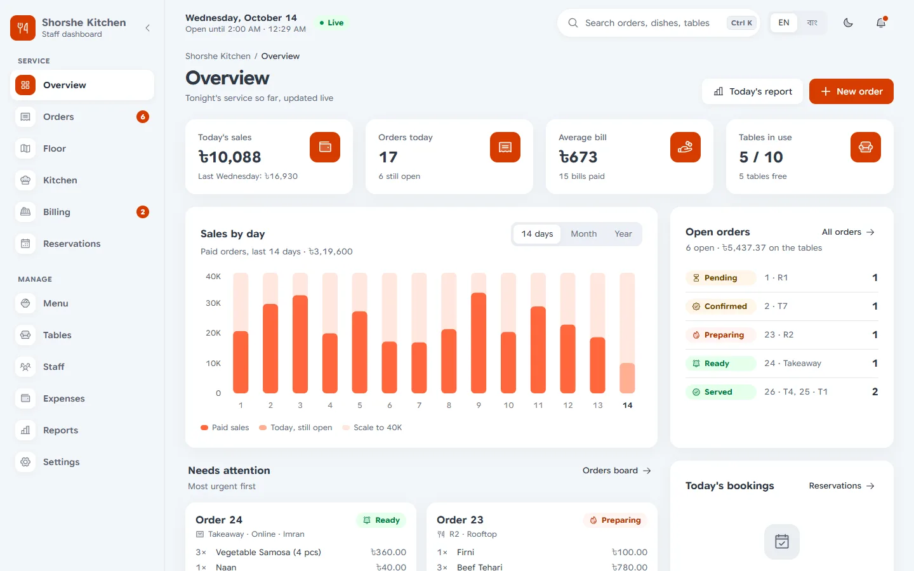
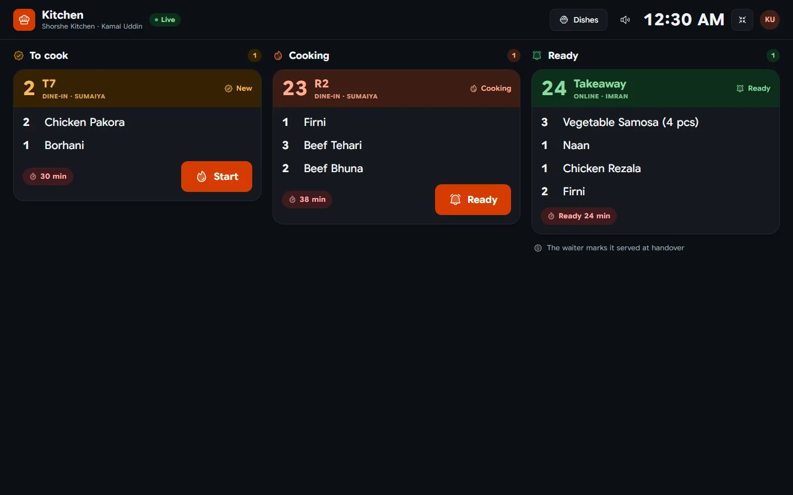
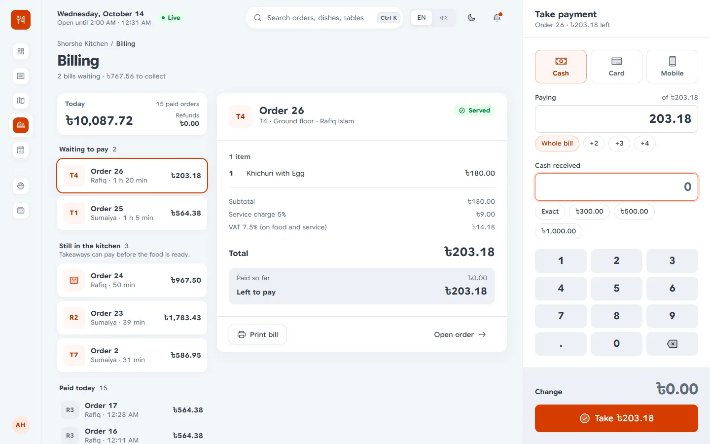
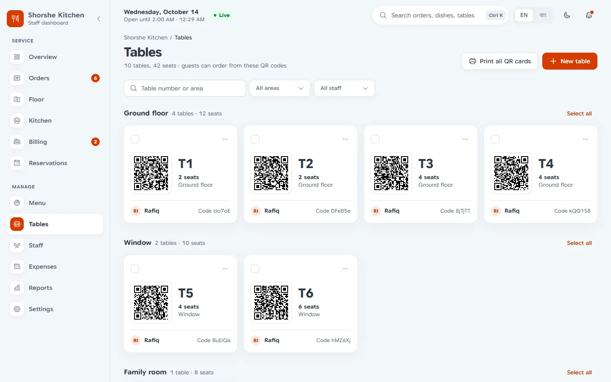
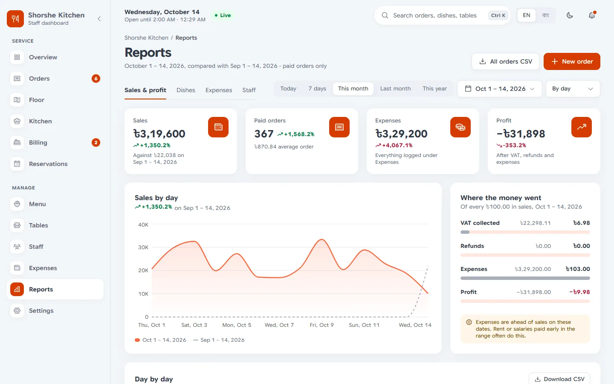
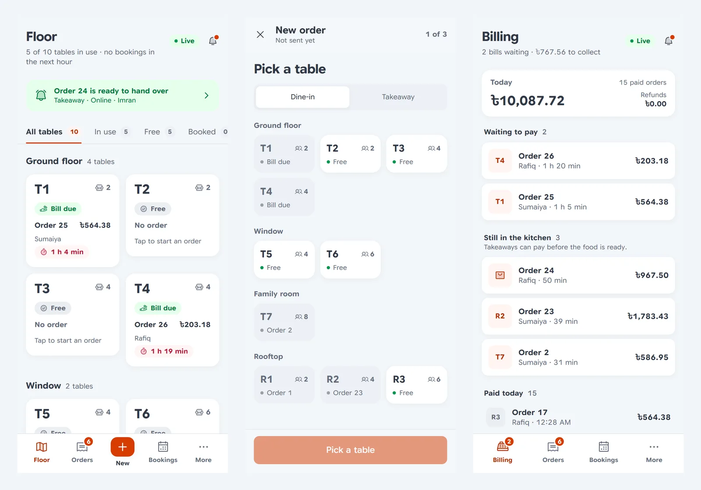

# BSS Restaurant

Staff dashboard for [bss-restaurant-fastapi](https://github.com/SharifdotG/bss-restaurant-fastapi).
Waiters take orders on their phones, the kitchen works from a live ticket board, the cashier
settles bills and prints receipts, and the manager watches the day and runs the menu, tables,
staff, expenses and reports. Everything updates live, in English or Bangla.

I built the API to be frontend agnostic, and this is the first frontend on top of it. It covers the
staff side. The customer side (ordering from the QR code on a table, online takeaway and
booking a table) comes later in the same project.



|                                                      |                                           |
| ---------------------------------------------------- | ----------------------------------------- |
|       |  |
|  |  |



## What each role gets

Everyone lands on the screen for their job, and only sees what their role is allowed to do. The
rules are the same ones the API checks, so the UI never shows a button the API would refuse.

| Role           | Lands on | Uses                                                                                                                         |
| -------------- | -------- | ---------------------------------------------------------------------------------------------------------------------------- |
| Manager, admin | Overview | Everything: today's numbers, orders, floor, kitchen, billing, reservations, menu, tables, staff, expenses, reports, settings |
| Waiter         | Floor    | Floor, orders, new order (made for a phone), reservations, the menu to read                                                  |
| Chef           | Kitchen  | A full screen dark ticket board, marking dishes sold out                                                                     |
| Cashier        | Billing  | Bills, split payments, change, receipts, orders, reservations, adding expenses                                               |

Some details I cared about:

- **Kitchen.** Tickets move from "to cook" to cooking to ready. Every bump has a five second undo
  window before it reaches the API, because the API can't move an order back. A "Start service" tap
  turns on the chime for new tickets, keeps the screen awake and goes full screen.
- **Billing.** Money is worked out in paisa (integers), never floats, so splits, cash received and
  change are exact. A bill can be split evenly or by any amount, and each part can be cash, card
  or mobile (bKash, Nagad, Rocket). Receipts come from the API's own 80 mm template and open
  in a preview before anything prints.
- **New order.** On a phone it goes table → menu → review. On a laptop it's a menu with the cart
  beside it. A draft stays on the device until it's sent.
- **Reservations.** A table × time grid for the day, requests waiting for a yes, and a booking
  sheet that lists the free tables for a time, smallest first.
- **Tables.** QR codes per table, printed four to an A4 sheet.
- **Reports.** Sales and profit, dishes, expenses and staff for any range, each with a CSV download.
- **Bangla.** The whole UI, digits, dates and taka amounts (৳১,২৩,৪৫৬.৫০) switch with the language.
- Light and dark themes (the kitchen is always dark), a ⌘K / Ctrl K palette for pages and search,
  and it works from a 390px phone up to a wall screen.

## Stack

- Next.js 16 (App Router, Turbopack), React 19 with the React Compiler, TypeScript
- Tailwind CSS v4 and shadcn/ui on Base UI, Phosphor icons, Google Sans Flex and Baloo Da 2
- TanStack Query over [openapi-fetch](https://openapi-ts.dev/openapi-fetch/), with types generated
  from the API's `openapi.json`
- next-intl for English and Bangla, nuqs for filters and pages in the URL
- Motion for animation, Recharts for charts
- Vitest for the logic, Playwright for end to end tests
- Hosted on Vercel (Hobby), deployed from the CLI

## Running locally

You need Node 24, pnpm and a running copy of the API. The API's README explains how to start it
and fill it with demo data (`seed-demo`). For this app its `CORS_ORIGINS` has to include
`http://localhost:3000`.

```bash
pnpm install
cp .env.example .env.local
pnpm dev
```

Then open http://localhost:3000 and sign in with one of the seeded accounts
(`manager@example.com`, `waiter@example.com`, `chef@example.com`, `cashier@example.com`, the
password is the one `seed-demo` printed).

## Configuration

| Variable                    | Description                                                                                  |
| --------------------------- | -------------------------------------------------------------------------------------------- |
| `NEXT_PUBLIC_API_ORIGIN`    | Where the API lives, without `/api/v1`. Default in `.env.example` is `http://localhost:8000` |
| `NEXT_PUBLIC_DEMO_LOGIN`    | `1` shows "look around as" buttons on the sign-in page for the seeded accounts               |
| `NEXT_PUBLIC_DEMO_PASSWORD` | The seeded accounts' password, used by those buttons                                         |

The demo buttons put a password into the page, so only turn them on where the accounts are meant
to be shared. Before they go on in production the API should lock the demo accounts against
password changes and similar.

## Scripts

| Command                       | What it does                                                                 |
| ----------------------------- | ---------------------------------------------------------------------------- |
| `pnpm dev`                    | Dev server on port 3000                                                      |
| `pnpm build`, `pnpm start`    | Production build and server                                                  |
| `pnpm lint`, `pnpm typecheck` | ESLint, TypeScript                                                           |
| `pnpm format`                 | Prettier (with the Tailwind class sorter)                                    |
| `pnpm test`                   | Vitest                                                                       |
| `pnpm e2e`                    | Playwright, see Tests                                                        |
| `pnpm api:pull [origin]`      | Saves the API's `openapi.json` into `src/lib/api/` (the live API by default) |
| `pnpm api:types`              | Generates `src/lib/api/schema.d.ts` from it                                  |

The OpenAPI document is committed, so the types only change when I pull on purpose.

## How it works

### Signing in

The API gives out a 15 minute access token and a 7 day refresh token. Refresh tokens are single
use, and using one twice logs out that whole session, so the client has to be careful.

- The browser logs in straight against the API, so the API's rate limits stay per visitor.
- The refresh token is then handed once to `POST /api/session`, a small route handler that keeps
  it in an httpOnly cookie. JavaScript never sees it again.
- `POST /api/session/refresh` swaps it for a new pair and returns only the access token and the
  user. `DELETE /api/session` logs out. The routes check `Origin` and `Sec-Fetch-Site`.
- Refreshes run inside a Web Lock and the fresh token is shared through localStorage, so several
  tabs waking up at once rotate the token once between them and nobody gets logged out. There's a
  Playwright test for exactly that.
- An expired token gets one refresh and one retry. Mutations are never retried on their own,
  because the API has no idempotency keys and a payment must not go through twice.
- `proxy.ts` only does locale routing and a quick redirect to sign-in when there's no cookie at all.

Pages are static shells and all data is fetched in the browser, which keeps the Vercel functions
down to the proxy and the three session routes.

### Live updates

One WebSocket per tab (`src/lib/live`). After it authenticates it gets a snapshot of the open orders
and today's bookings, then changes as they happen. The kitchen, floor and billing read from that
store, and the matching TanStack Query caches are refreshed in the background. It re-authenticates
after a token refresh, reconnects with backoff, and watches for silence in case the connection
dies without closing. The top bar shows whether it's live.

### Project layout

```
src/
  app/[locale]/(auth)/     sign in
  app/[locale]/(app)/      the staff pages, one folder per page
  app/[locale]/t/[token]/  public page behind a table's QR code
  app/api/session/         session cookie routes
  proxy.ts                 locale routing and the sign-in redirect
  components/ui/           shared primitives (button, input, dialog, table, segmented...)
  components/<area>/       orders, pos, kitchen, billing, reservations, menu, staff...
  lib/api/                 openapi.json, generated types, client, error messages
  lib/session/             tokens, refresh lock, cookie
  lib/live/                websocket client and live store
  lib/*.ts                 money, formatting, permissions and the logic for each area
  i18n/                    next-intl setup
messages/                  en.json, bn.json
e2e/                       Playwright tests
```

## Tests

```bash
pnpm test
```

Vitest covers the logic that's easy to get wrong: money and split maths, the permission table, the
refresh lock, live store updates, kitchen timers, report ranges, booking times and so on.

The Playwright tests run against a production build and a local API with the demo seed, in the
Edge that's already installed (no browser download):

```bash
pnpm build
pnpm e2e
```

They check that every role lands on its own page, that two tabs share one token refresh, and one
whole service: a waiter sends an order, the chef cooks it, the waiter serves it and the cashier
splits the bill between cash and card and opens the receipt. The API allows five sign-ins per
account in five minutes, so running the suite twice in a row hits that limit.

## Deploying

It runs on Vercel's Hobby plan and I deploy from my machine:

```bash
vercel deploy --prod
```

Set `NEXT_PUBLIC_API_ORIGIN` in the Vercel project, and add the deployment's URL to the API's
`CORS_ORIGINS`. The session routes run in `iad1`, the same region as the API.

## Credits

The sign-in photo is by [Haizam Muhammed](https://unsplash.com/photos/xL0uEoH7L9E) on Unsplash.
