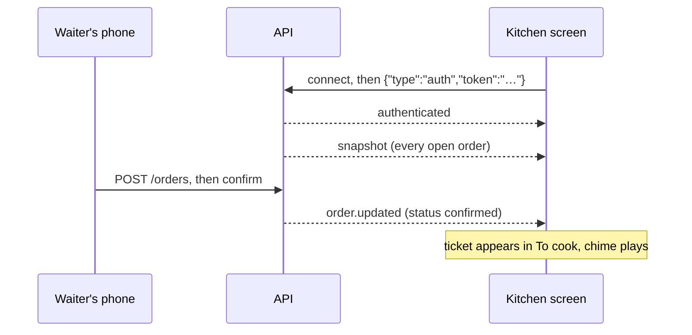

import { Why } from "/snippets/why.jsx";
import { Source } from "/snippets/source.jsx";

When a waiter sends an order, the kitchen screen shows the ticket a second later. When the chef marks it ready, the waiter's phone and the cashier's queue change too. Nobody refreshes anything. This page explains how.

## A WebSocket, not polling

The obvious way would be for every screen to ask the API "anything new?" every few seconds. With ten screens open that's a lot of requests that mostly get "no", and it's still a few seconds late.

Instead each signed-in tab opens one [WebSocket](/reference/glossary#websocket) to the API at `/api/v1/live`. A WebSocket is a connection that stays open, so the API can push a message the moment something changes.



## Connecting

The connection lives in <Source path="src/lib/live/socket.ts" />. `AppShell` starts it once when you're signed in and stops it when you sign out.

1. Open the socket and send `{"type": "auth", "token": "..."}` with the current access token. The token goes in a message rather than the URL so it never shows up in a log of addresses. The API waits 10 seconds for it, then closes the connection.
2. The API answers `authenticated`. The status chip in the top bar turns to **Live**.
3. The API sends a `snapshot`: every open order and today's bookings, as of now.
4. From then on it sends events as they happen: `order.created`, `order.updated`, `reservation.created`, `reservation.updated`.

The API decides what each role hears. A chef only gets orders, not bookings. When the access token is refreshed, the open socket is sent the new token, so it doesn't drop.

## When the connection drops

Wi-Fi in a restaurant isn't always kind, so most of the socket code is about getting back:

| What happened | What the dashboard does |
| --- | --- |
| The connection closed for an ordinary reason | Tries again after 1 s, then 2, 4, 8… up to 30 s, with a little randomness so every tablet doesn't reconnect at the same instant |
| Nothing heard for 60 seconds | Assumes the line is dead and reconnects. The API pings every 25 seconds, so this means two missed pings |
| The API closed with `4401 token_expired` | Gets a fresh token and reconnects straight away |
| The API closed with another `4401`, `4400` or `4403` | Stops. The token or the request is bad, and retrying won't change the answer |
| The browser went offline | Shows **Offline** and waits for it to come back |
| The tab became visible again, or the network came back | Reconnects at once instead of waiting out the backoff |

```ts src/lib/live/socket.ts
function scheduleReconnect() {
  if (!wanted) return;
  clearTimeout(retryTimer);
  setStatus(navigator.onLine ? "reconnecting" : "offline");
  // 1 s, 2 s, 4 s … capped at 30 s, with jitter so a restart doesn't get every tablet at once.
  const delay = Math.min(30_000, 1000 * 2 ** attempts) * (0.75 + Math.random() * 0.5);
  attempts += 1;
  retryTimer = setTimeout(open, delay);
  setTiming({ retryAt: Date.now() + delay });
}
```

If it's still down after 10 seconds, a banner explains what's happening, how long it's been, and offers **Retry now**. On the kitchen screen it's a red bar across the top, because a silent kitchen board is a real problem.

## The live store

Events land in a small store, <Source path="src/lib/live/store.ts" />, that holds the open orders and today's bookings. The kitchen board, the billing queue, the incoming-orders panel and the notification bell all read from it with hooks like `useLiveOrders()`.

The rules for updating it are pure functions in <Source path="src/lib/live/state.ts" />, which keeps them easy to test:

- A **snapshot** replaces everything.
- An **event** only counts if its `updatedAt` is newer than what the store already has. Messages can arrive out of order after a reconnect, and an old one must never overwrite a newer one.
- **Paid and cancelled** orders leave the store, so they drop off every live board.
- Some events are too big to send whole. They arrive as `{"id": 42, "partial": true}`, and the store fetches order 42 from the API.

```ts src/lib/live/state.ts
const newer = (incoming: { updatedAt: string }, current?: { updatedAt: string }) =>
  !current || Date.parse(incoming.updatedAt) > Date.parse(current.updatedAt);
```

## Keeping the other pages fresh

Pages like the orders list and the overview don't read the live store. They fetch through [TanStack Query](/how-it-works/data-and-caching), which caches results. <Source path="src/lib/live/query-sync.ts" /> connects the two: an order event marks the cached orders list, that order's page and the dashboard figures as out of date, and TanStack Query refetches whatever's on screen.

Events are collected for one second and handled together, so a burst of ten changes causes one refetch, not ten.

## Clocks that agree

The kitchen timer says how long a ticket has waited. If the tablet's clock is two minutes off, every ticket would look two minutes older or younger. So the snapshot carries the server's time, the store remembers the difference from the device's clock, and every timer uses server time. Two tablets side by side show the same numbers.

<Why>
  Polling every few seconds would have been simpler to write. But a kitchen ticket that shows up five seconds late gets cooked five seconds late, and a cashier watching a bill that doesn't move starts refreshing the page. The live feed is the reason the screens feel like one system rather than five websites.
</Why>
