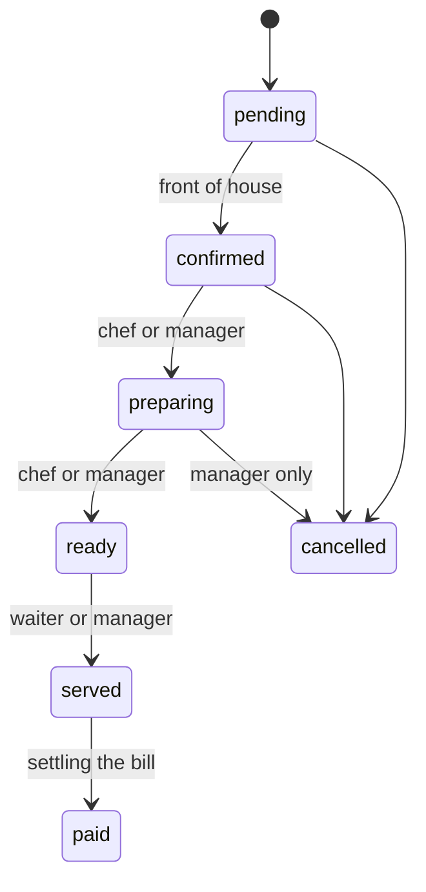

import { Why } from "/snippets/why.jsx";
import { Source } from "/snippets/source.jsx";
import { Pill } from "/snippets/pill.jsx";

Every account has one role: **admin**, **manager**, **cashier**, **waiter** or **chef**. The API enforces what each role may do. The dashboard copies those rules so it never shows a button that would only get a "you can't do that" back.

All of it is in one file, <Source path="src/lib/permissions.ts" />. The sidebar, the bottom tabs, the command palette and every action button read from it.

<Note>
  The dashboard's rules decide what to **show**. The API decides what's **allowed**. If the two ever disagree, the API wins and the person sees its error message. Nothing on the client is a security check.
</Note>

## Who lands where

Each role opens on the screen for their job:

| Role | Lands on | Typical device |
| --- | --- | --- |
| Admin, manager | [Overview](/workspaces/overview-and-reports) | Laptop or desktop |
| Waiter | [Floor](/workspaces/floor) | Phone |
| Chef | [Kitchen](/workspaces/kitchen) | Landscape tablet or wall screen |
| Cashier | [Billing](/workspaces/billing) | Laptop or tablet at the counter |

## Who can open which page

Admin can open everything and isn't listed.

| Page | Manager | Cashier | Waiter | Chef |
| --- | :---: | :---: | :---: | :---: |
| Overview | ✓ | ✓ | | |
| Orders, New order, Floor, Reservations | ✓ | ✓ | ✓ | |
| Kitchen | ✓ | | | ✓ |
| Billing | ✓ | ✓ | | |
| Menu | ✓ | ✓ | ✓ | ✓ |
| Expenses | ✓ | ✓ | | |
| Tables, Staff, Reports, Settings | ✓ | | | |
| Profile | ✓ | ✓ | ✓ | ✓ |

Pages a role can't open are left out of its navigation. If someone types the address anyway, the page shows a calm card instead of the content, "Only managers can open Reports", with a button back to their own landing page. The URL doesn't change, so a manager reading over their shoulder can still see what was meant.

## Who can do what

Opening a page and acting on it are separate. A waiter can open the menu but only read it; a chef can open it to mark dishes sold out.

| Action | Who |
| --- | --- |
| Create and edit orders, manage bookings | Manager, cashier, waiter |
| Take payments, add expenses, see the overview figures | Manager, cashier |
| Mark dishes sold out | Manager, chef |
| Refund, edit the menu, delete expenses, manage tables, staff and settings, read reports | Manager |

```ts src/lib/permissions.ts
const ACTION_ROLES: Record<Action, readonly Role[]> = {
  "order.create": FRONT,
  "order.edit": FRONT,
  "order.pay": [...MANAGERS, "cashier"],
  "order.refund": MANAGERS,
  "menu.edit": MANAGERS,
  "menu.soldOut": [...MANAGERS, "chef"],
  // ...
};

export const can = (role: Role, action: Action) => allows(ACTION_ROLES[action], role);
```

`FRONT` is manager, cashier and waiter, the front of house. Admin always passes `allows()`.

## Moving an order along

Orders move through fixed steps. Who may move one depends on where it's going:



| Moving to | Who |
| --- | --- |
| <Pill tone="amber">Confirmed</Pill> | Manager, cashier, waiter |
| <Pill tone="orange">Preparing</Pill> and <Pill tone="green">Ready</Pill> | Manager, chef |
| <Pill tone="green">Served</Pill> | Manager, waiter |
| <Pill tone="slate">Paid</Pill> | Nobody by hand. It happens when the balance reaches zero |
| <Pill tone="red">Cancelled</Pill> | Front of house, but only a manager once the kitchen has started |

The API sends each order with a `nextStatuses` list, the steps that are possible from here. It doesn't know who's asking, so the dashboard narrows that list to the steps the current role may take:

```ts src/lib/permissions.ts
export function orderMoves(role: Role, order: OrderLike): OrderStatus[] {
  const next = order.nextStatuses ?? ORDER_FLOW[order.status];
  return next.filter((target) => {
    const roles = ORDER_MOVE_ROLES[target];
    if (!roles || !allows(roles, role)) return false;
    if (target === "cancelled" && order.status === "preparing") return allows(MANAGERS, role);
    return true;
  });
}
```

A few more rules sit beside it, each a small function the screens call:

- **Cancelling needs a reason**, and an order that has taken money needs a refund first.
- **Items can be swapped or removed** while the order is pending or confirmed. Once it's cooking, you can only add.
- **A payment can be taken** if you're allowed to take payments, the order is still open, and something is left to pay.
- **A booking can't be marked no-show** before its start time, and can't be confirmed after it has ended.

## Staff accounts

Managers create sign-ins for staff, but can't touch other managers or admins. Only an admin can make someone a manager. The rule is `canManageAccount()`, and the Staff page only offers the buttons it allows.

<Why>
  I kept every rule in one file rather than sprinkling `role === "manager"` through the components. When the API's rules change, there's one place to follow, and `permissions.test.ts` checks the whole table for every role. It also means the sidebar, the shortcuts and the command palette can never disagree about what a waiter may open.
</Why>
