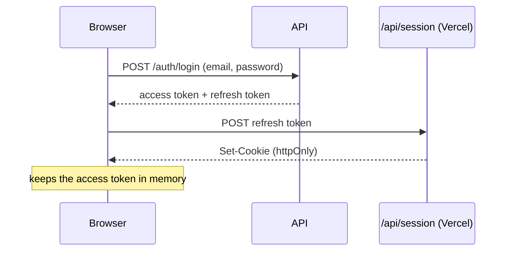
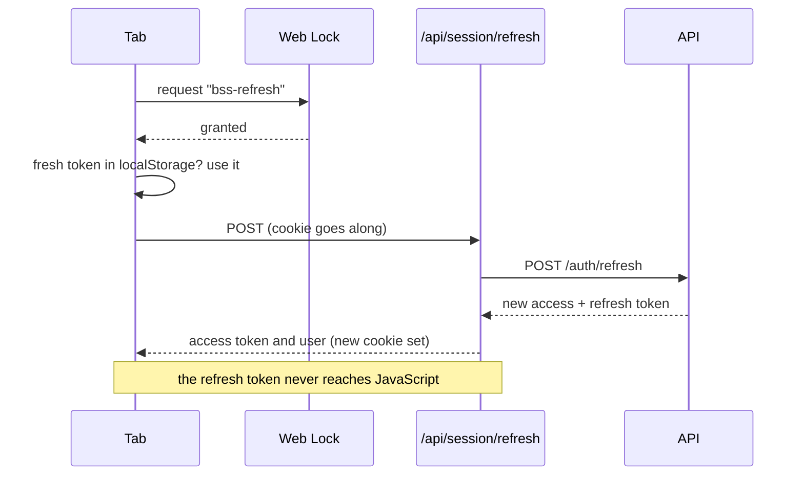

import { Why } from "/snippets/why.jsx";
import { Source } from "/snippets/source.jsx";

Signing in looks like one form, but behind it are two tokens with very different jobs and a set of rules that keep several open tabs from tripping over each other. This is the most delicate part of the dashboard, so it has the most tests.

## Two tokens

When you sign in, the API hands back a pair:

| | Access token | Refresh token |
| --- | --- | --- |
| **What it's for** | Sent with every request to prove who you are | Swapped for a new pair when the access token runs out |
| **Lives for** | 15 minutes | 7 days |
| **Kept in** | The tab's memory, plus a copy in `localStorage` | An `httpOnly` cookie that JavaScript can't read |
| **Can be used** | As often as you like until it expires | **Once.** Using it gives you a new refresh token |

The access token is a [JWT](/reference/glossary#jwt): a signed note saying "user 7, a waiter, until 9:45". The API checks the signature without looking anything up, which is fast, but it can't take a JWT back once issued. That's why it only lives 15 minutes.

The refresh token is the one that matters. If someone stole it they could stay signed in for a week, so the dashboard never lets page scripts touch it.

## Signing in



1. The sign-in form sends your email and password **straight to the API**, so the API's per-person attempt limits count your own attempts.
2. The browser passes the refresh token once to `POST /api/session`, a small route on the dashboard's own server.
3. That route stores it in a cookie marked `httpOnly`, `Secure` and `SameSite=Lax`, and named `__Host-bss_session`. From here on, page scripts can't read it.
4. The access token stays in memory, with a copy in `localStorage` so a reload or a new tab doesn't need a new one.

If you untick **Remember me**, the cookie has no expiry date and the browser drops it when it closes.

<Note>
  On plain `http://localhost` the cookie is called `bss_session` and isn't marked `Secure`, because browsers only accept `Secure` cookies over HTTPS.
</Note>

## Staying signed in

An access token lasts 15 minutes, so the dashboard quietly gets a new one at about 80% of that, around the 12-minute mark:



The refresh route on Vercel reads the cookie, asks the API for a new pair, stores the new refresh token in the cookie and returns only the access token. It also passes the browser's `User-Agent` along: the API notes it against each refresh token, and it should record your browser, not Vercel's server.

## The hard part: several tabs

Here's the trap. A refresh token works **once**. If the API ever sees the same refresh token twice, it assumes it was stolen and signs out every device in that session. That's a good security rule, and it's also exactly what happens if two tabs refresh at the same moment with the same cookie.

The dashboard prevents it with three things, all in <Source path="src/lib/session/client.ts" />:

- **A [Web Lock](https://developer.mozilla.org/docs/Web/API/Web_Locks_API).** Every refresh runs inside `navigator.locks.request("bss-refresh", ...)`. The browser lets only one tab hold that lock at a time, across every tab of the site.
- **A look before rotating.** Inside the lock, a tab first checks `localStorage`. If another tab refreshed a moment ago, there's already a fresh token there, and this tab just uses it.
- **A [BroadcastChannel](https://developer.mozilla.org/docs/Web/API/BroadcastChannel)** called `bss-session` tells the other tabs about every refresh, sign-in and sign-out.

```ts src/lib/session/client.ts
export async function refresh(rejected?: string): Promise<Session | null> {
  const run = async () => {
    const cached = readCache();
    if (cached && isFresh(cached) && cached.accessToken !== rejected) {
      adopt(cached);
      return cached;
    }

    const result = await rotate();
    if (result === "anonymous") {
      signOutLocally();
      post({ type: "signed-out" });
      return null;
    }
    // ...
    writeCache(result);
    adopt(result);
    post({ type: "refreshed", session: result });
    return result;
  };

  return navigator.locks ? navigator.locks.request(LOCK_NAME, run) : run();
}
```

So when five tabs wake up at once after a laptop sleeps, one tab rotates the token and the other four find a fresh one waiting. The unit tests cover this, and a Playwright test reloads two tabs at the same moment with an old token and checks both stay signed in.

<Why>
  I could have asked for a grace window on the API, a few seconds where reusing a refresh token is forgiven. I'd rather the API stays strict and the client behaves, because a stolen token is exactly the case where a grace window helps the wrong person.
</Why>

## Guarding the session routes

The three session routes accept requests only from the dashboard's own pages. Each checks that the `Origin` header matches the site, and that `Sec-Fetch-Site` (sent by modern browsers) says `same-origin`. Another website can't make your browser call them, which is the attack called [CSRF](/reference/glossary#csrf).

| Route | What it does |
| --- | --- |
| `POST /api/session` | Stores the refresh token from sign-in in the cookie |
| `POST /api/session/refresh` | Swaps the cookie's token for a new pair, returns the access token |
| `DELETE /api/session` | Tells the API to log out, then clears the cookie |

They live in <Source path="src/app/api/session/route.ts" /> and <Source path="src/app/api/session/refresh/route.ts" />. If the API is down during a refresh, the route answers 503 and **keeps** the cookie, so you're still signed in when it comes back. Only a clear "this token is no good" from the API clears it.

## Before a page even loads

<Source path="src/proxy.ts" /> runs on the server before every page. It does two jobs:

1. **Language.** A URL without `/en` or `/bn` is redirected to your saved language, or English.
2. **A quick sign-in check.** If you open a dashboard page and there's no session cookie at all, it redirects you to `/en/login?next=/orders`, and you come back to the same page after signing in.

It only checks that the cookie exists, not that it's valid. That keeps it fast. The page confirms the session properly a moment later with a refresh, and if that fails, `SessionGate` sends you to the sign-in page.

Roles aren't checked here. A waiter who opens the Reports address gets a friendly "this isn't part of your role" card inside the dashboard. See [Roles and permissions](/how-it-works/roles-and-permissions).

## Signing out

Signing out tells the API to revoke the refresh token, clears the cookie, and removes what this browser kept for you: the access token, any unsent order drafts, the kitchen's ticked-off lines, and the "already seen" flags for first-visit animations. Other tabs hear about it on the BroadcastChannel and sign out too.

**Sign out everywhere** in the user menu also tells the API to revoke every session on every device.

If someone else signs in on the same browser, every open tab reloads, so one person's orders never show up under another person's name.

## Changing your password

The API signs out every other device when a password changes, and returns a fresh pair for this one. The profile page hands that pair straight to the session store, so you stay signed in here.
