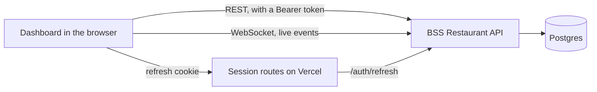

import { Why } from "/snippets/why.jsx";
import { Source } from "/snippets/source.jsx";

The dashboard keeps no data of its own. Every dish, order and booking lives in the API's database, and the dashboard asks for it over HTTP, the same way any other app could. This page follows one request from a button press to the screen.

## The big picture



There are three kinds of traffic:

1. **Ordinary requests** go straight from your browser to the API: list the orders, add a payment, mark a dish sold out. Each carries a short-lived access token.
2. **The live feed** is one WebSocket per signed-in tab. The API pushes order and booking changes down it the moment they happen. See [Live updates](/how-it-works/live-updates).
3. **Session upkeep** goes through three small routes on the dashboard's own server, because the long-lived refresh token is kept in a cookie JavaScript can't read. See [Sign-in and sessions](/how-it-works/sign-in-and-sessions).

<Why>
  Requests go straight to the API instead of through a Next.js server in the middle. That keeps the pages static and fast to serve, keeps Vercel's free-plan usage tiny, and means the API's per-visitor limits still see each visitor's own address.
</Why>

## Where the API is

One setting decides it, `NEXT_PUBLIC_API_ORIGIN`, read in <Source path="src/lib/api/config.ts" />:

```ts src/lib/api/config.ts
export const API_ORIGIN = (process.env.NEXT_PUBLIC_API_ORIGIN ?? "http://localhost:8000").replace(
  /\/$/,
  "",
);
export const API_BASE = `${API_ORIGIN}/api/v1`;
export const LIVE_URL = `${API_ORIGIN.replace(/^http/, "ws")}/api/v1/live`;
```

The `NEXT_PUBLIC_` prefix tells Next.js the value is safe to ship to the browser. It's baked in when the app starts or builds, so changing it means restarting `pnpm dev` or redeploying.

## Types generated from the API

FastAPI describes every endpoint in an [OpenAPI](https://www.openapis.org) file: the path, the parameters, and the exact shape of the request and the response. The dashboard keeps a copy of that file and turns it into TypeScript types:

```bash
pnpm api:pull    # saves the live API's openapi.json into src/lib/api/
pnpm api:types   # turns it into src/lib/api/schema.d.ts
```

The copy is pulled on purpose, not on every build, so the types only change when you decide to update them. After an API change you run both, and TypeScript points at every place in the dashboard that needs to follow.

## The client

All requests go through one [openapi-fetch](https://openapi-ts.dev/openapi-fetch/) client, `api`. Because it knows the types, the editor completes paths and parameters, and a typo is a build error:

```ts
const { data } = await api.GET("/api/v1/orders/{order_id}", {
  params: { path: { order_id: 42 } },
});
// data is an OrderDetailOut: number, items, payments, history, nextStatuses…
```

The client has one piece of middleware, in <Source path="src/lib/api/client.ts" />. It adds the access token to every request and, if the API answers 401 because the token just expired, gets a fresh one and sends the request again, once:

```ts src/lib/api/client.ts
const auth: Middleware = {
  async onRequest({ request, id }) {
    const token = await accessToken();
    if (!token) return;
    request.headers.set("authorization", `Bearer ${token}`);
    sent.set(id, request.clone());
    return request;
  },

  async onResponse({ response, id }) {
    const original = sent.get(id);
    sent.delete(id);
    if (response.status !== 401 || !original) return;

    const rejected = original.headers.get("authorization")?.replace("Bearer ", "");
    const renewed = await refresh(rejected);
    if (!renewed) return;

    original.headers.set("authorization", `Bearer ${renewed.accessToken}`);
    return fetch(original);
  },
  // ...
};
```

A request body can only be read once, which is why the middleware keeps a `clone()` of each signed request to resend. The retry uses plain `fetch`, so it can never loop. A failed sign-in has no token attached, so it's never retried.

## Errors that make sense

When the API says no, its answer has a machine-readable `code` and a human `detail`:

```json
{ "detail": "Refund what was paid before cancelling the order", "code": "refund_required", "amountPaid": 450.0 }
```

`unwrap()` turns any non-OK answer into an `ApiError`, and <Source path="src/lib/api/errors.ts" /> works out what to tell the person at the screen:

- 57 of the API's error codes have their own message in both languages, under `errors.codes` in the message files. `refund_required` reads "৳450.00 has already been paid. Refund it before this change.", with the amount filled in.
- Any other code falls back to a message for its status: 403 "Your role can't do this.", 409 "This changed while you were working on it…", 500 and up "Something went wrong on the server…", and no answer at all "Can't reach the server…".
- `429 Too Many Requests` carries `retryAfter` in seconds, which becomes "Too many tries. Wait 3 minutes and try again." 
- `422` validation errors list the fields that failed. Forms show each message under its own field.

## CORS, briefly

Browsers block a page from calling another site's API unless that API says it's fine. That rule is called CORS (Cross-Origin Resource Sharing). The dashboard at `localhost:3000` and the API at `localhost:8000` count as different sites, so the API has to list the dashboard's address in its `CORS_ORIGINS` setting. Forgetting it is the most common reason a fresh setup can't sign in: the browser shows a network error even though the API is running.

## Images

Dish, category, table and staff photos come from the API, already resized to WebP. Locally they're served by the API itself (`/media/...`), in production from Cloudflare R2 (a full `https://` address). `imageUrl()` in <Source path="src/lib/api/images.ts" /> adds the API's address in front of the local kind and leaves the R2 kind alone. The images skip Next.js's own image optimisation, since the API already did that work.
