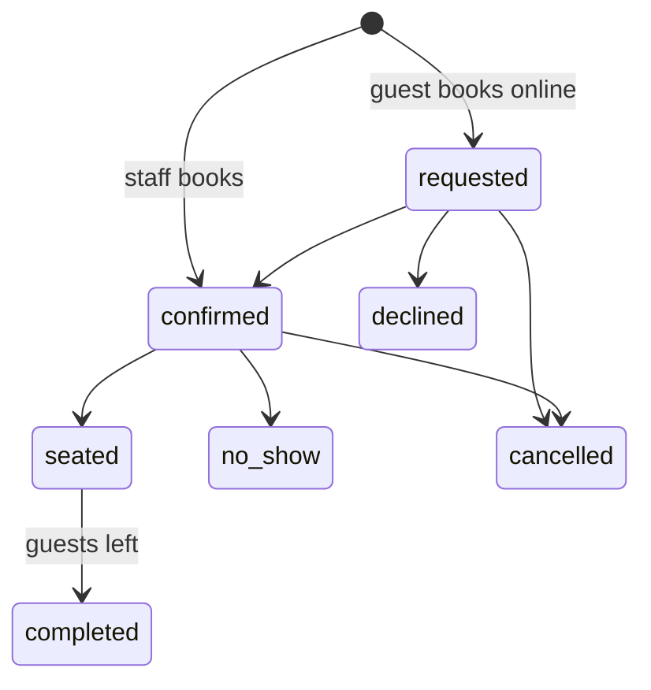

import { Why } from "/snippets/why.jsx";
import { Source } from "/snippets/source.jsx";
import { Shot } from "/snippets/shot.jsx";
import { Pill } from "/snippets/pill.jsx";

## Reservations

**Who uses it:** managers, cashiers and waiters. Anyone on the front desk can take and manage bookings.

<Shot name="reservations" alt="The reservations grid: tables down the left grouped by area, hours across the top, bookings as blocks, a line for now, and a panel of booking requests" />

The day is a grid: tables down the side, grouped by area, and hours across the top, from opening to closing time (past midnight if the restaurant stays open late). Each booking is a block across its table and time. A line marks now, and the grid opens scrolled to it.

### Booking states

<Pill tone="amber">Requested</Pill> <Pill tone="green">Confirmed</Pill> <Pill tone="orange">Seated</Pill> <Pill tone="slate">Completed</Pill> <Pill tone="red">No-show</Pill> <Pill tone="slate">Cancelled</Pill> <Pill tone="slate">Declined</Pill>

- Bookings made by staff start **confirmed**. Online requests from guests start **requested** and wait in a panel beside the grid.
- **Confirm** on a request picks the smallest free table that fits, and the card says which one before you press it.
- **Seat guests** marks them as arrived, and a toast offers to start their order on that table.
- A confirmed booking 15 minutes past its start time gets a <Pill tone="amber">late</Pill> label, and its details suggest the next step: "They're 15 min late. Give them a call, or mark a no-show to free the table." No-show isn't offered before the start time.
- **Guests left** completes it. Once the table's bill is paid and nothing is open, the details say so ("T4 has paid and has nothing open. If they've left, free the table.") and **Guests left** becomes the main button.
- **Decline** and **Cancel** need a reason, which the guest sees when they check their booking.

### Making a booking

Click an empty part of the grid to book that table at that time, or use **New booking**. The sheet offers:

- Times in 15-minute steps inside opening hours (past times are hidden for today).
- A length: 60 to 180 minutes, defaulting to the restaurant's setting.
- Tables that are free for the whole slot, from the API's availability check, smallest that fits first. Tables with an order on them right now are marked, in case the guests are lingering.

If someone else takes the table while you're filling in the form, the list refreshes and says so.

### Finding and printing

Search finds bookings by name, phone or booking code on any date, grouped by day. **Print** makes an A4 sheet of the day's bookings with a tick column for the door. On a phone the grid becomes a week strip and a list for the chosen day.

All of this lives in the URL (`?day=2026-10-16&booking=31`), so the back button and shared links work.

## Tables

**Who uses it:** managers.

<Shot name="tables" alt="The tables page: QR code cards for each table grouped by area, with seats, area and assigned staff" />

Each table is a card with its QR code, seats, area and assigned staff. Managers add, edit, switch off and assign staff here, alone or several tables at once.

- **QR codes** link to `/t/<token>` on the dashboard's site. A guest who scans one gets a welcome page for that table with the restaurant's hours. Ordering from the phone comes in a later version.
- **Print QR** lays out four cards per A4 page, with cut lines, the table number, and a line in English and Bangla.
- **New code** replaces a table's QR token. The old printed card stops working, which is the point if a card goes missing.
- **Switching off** a table, or lowering its seats, lists any upcoming bookings that would be affected first.
- A table that has ever had an order can't be deleted, because orders point at it. The dashboard offers to switch it off instead.

<Why>
  I gave the grid hour columns because that's how a front desk thinks: "what's free at 8?" is one vertical glance down the 8 o'clock column. Clicking an empty cell to book it works like a paper bookings sheet, where you point at the gap and write in it.
</Why>

## Files

| | |
| --- | --- |
| Reservations | `src/components/reservations/`: `booking-grid.tsx`, `waiting-panel.tsx`, `booking-sheet.tsx`, `booking-details.tsx`, `day-sheet.tsx` |
| Tables | `src/components/tables/`, the guest page in `src/components/guest/` |
| Logic | <Source path="src/lib/reservations.ts" />, <Source path="src/lib/hours.ts" />, <Source path="src/lib/tables.ts" />, tested in `reservations.test.ts` and `hours.test.ts` |
